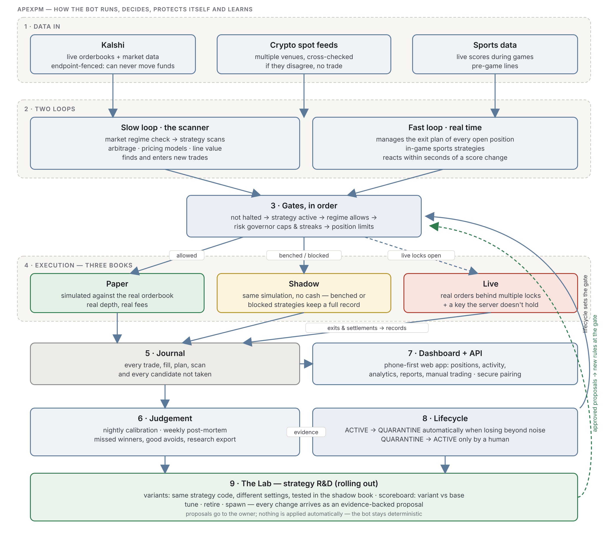

<p align="center"></p>

# ApexPM

**An automated arbitrage scanner and execution bot for Kalshi prediction markets, with a React dashboard for monitoring, journaling and AI-assisted performance reviews.**

I built this end to end with Claude as my pair programmer. The aim was to see how far AI-assisted development could take a non-engineer from an idea to a deployed, risk-managed system.

> ⚠️ **Paper trading by default. Not financial advice.** `DRY_RUN=true` and `USE_DEMO=true` are the shipped defaults. The strategy values in this repo are deliberately conservative placeholders, not tuned values.

## Status

This public repo is **V2**: the architecture, strategy set and safeguards described below, kept as a readable reference. Active development continues in a private **V3** that is currently in paper validation against live Kalshi orderbooks (real fills, slippage and fees recorded, no real orders). V3 adds a persisted risk governor (daily / weekly / monthly loss caps, profit lock, drawdown-scaled sizing, per-strategy loss streaks), a regime detector that throttles or pauses strategies when market conditions change, portfolio-aware Kelly sizing, a plain-language activity feed, and a phone-first control dashboard with a kill switch. This repo receives security fixes only. Nothing here is a tuned, profitable configuration, and no live-money results are claimed.


## V3 at a glance

<p align="center"></p>

V3 runs every strategy inside a governance harness. Two loops generate trades: a scanner that finds and enters new trades, and a real-time loop that manages exits and reacts to live games. Every order passes ordered risk gates into one of three books (paper, shadow, or a locked live book), and everything is journaled. The journal feeds analytics, nightly and weekly reviews, and lifecycle rules that automatically bench a losing strategy; only a human can reinstate one. The Lab tests strategy variants in the shadow book and turns the evidence into proposals. Nothing changes automatically.

It is built spec-first: every strategy and agent starts as a written spec (where the edge comes from, kill criteria, minimum sample) before any code, and every change passes an independent review and the CI test suite before it ships.

---

## What it does

Every scan cycle, the bot pulls live markets from the Kalshi v2 API, looks for mispricings, sizes positions with fractional Kelly, and either logs the trades it would make (dry run) or places signed orders.

| Strategy | Idea |
|---|---|
| **YES/NO arb** | If `YES bid + NO bid` is meaningfully under $1, the pair is mispriced. |
| **Multi-outcome arb** | In mutually exclusive events (e.g. "who wins"), exactly one YES pays $1. If the sum of all YES asks is under $1, buying every leg locks in the spread. |
| **Cross-platform** | Uses Polymarket prices as an oracle and buys the cheap side on Kalshi when the two disagree. |
| **Lottery** *(off by default)* | Small, capped bets on very cheap, high-volume contracts. |

## Architecture

```
            ┌──────────────────────┐        ┌──────────────────┐
            │   Kalshi API v2      │        │  Polymarket API  │
            │ (RSA-PSS signed)     │        │  (price oracle)  │
            └─────────┬────────────┘        └────────┬─────────┘
                      │                              │
                ┌─────▼──────────────────────────────▼─────┐
                │  bot/bot.py  — scan → score → size →      │
                │  guardrails → execute (or dry-run log)    │   long-running worker on any
                └─────┬───────────────────────────┬─────────┘   host (Render, Fly, a VPS…)
                      │                           │
               ┌──────▼──────┐             ┌──────▼───────┐
               │  SQLite     │             │ Daily email  │
               │ trades,     │             │ report       │
               │ opportunities│            │ (SendGrid)   │
               └─────────────┘             └──────────────┘

   dashboard/ — React + Vite + Recharts (Vercel): P&L, positions, trade
   journal, strategy toggles, and a Claude-powered weekly/monthly review
```

## Safeguards

Risk controls come first. The strategies come second.

- **Dry run by default.** Real orders need `DRY_RUN=false` set on purpose, and the dashboard has its own confirmation step before live mode.
- **Portfolio kill switch.** Trading halts if the balance falls 15% below the starting balance.
- **Duplicate-trade guard.** The bot skips any event or ticker it already holds, so it never stacks exposure on a repeat signal.
- **Hard caps.** Per-trade dollar and contract caps until the bankroll clears a safe balance, a max number of concurrent positions, and a max share of the balance per event.
- **Liquidity filters.** Minimum 24h volume and maximum bid-ask spread for every leg, so "edge" isn't just an illiquid quote.
- **Stop-loss cooldown.** Stop-losses don't fire during the entry-spread noise right after a fill.
- **The dashboard never handles credentials.** Keys live only in the bot's server environment variables, and logs are kept free of key material.
- **Exits are sells, never buys.** Exit orders are `sell` + `reduce_only`, so an exit can never add to or flip a position.

## Quick start

**Bot**
```bash
cd bot
python -m venv .venv && source .venv/bin/activate
pip install -r requirements.txt
cp ../.env.example .env        # add your Kalshi demo key; leave DRY_RUN=true
python bot.py
```

**Dashboard**
```bash
cd dashboard
npm install
npm run dev
```

Every strategy setting can be overridden from `.env` (see `.env.example`), so you can tune it without touching code.

## Built with AI

I directed this project with Claude doing most of the implementation. I spec'd the strategies and guardrails, then reviewed the output and checked it in dry runs. Later iterations came from reading the bot's own logs of rejected opportunities ("missed trades") and asking why. The dashboard's AI review sends a trading period to Claude and returns specific parameter recommendations.

*(The in-dashboard AI review is built for Claude's artifact runtime. To run it standalone, put a small server-side proxy in front of the API. Never ship an API key to the browser.)*

## License

MIT

The ApexPM logo in `assets/` is © the project owner and is not covered by the MIT license; ask before reusing it.
